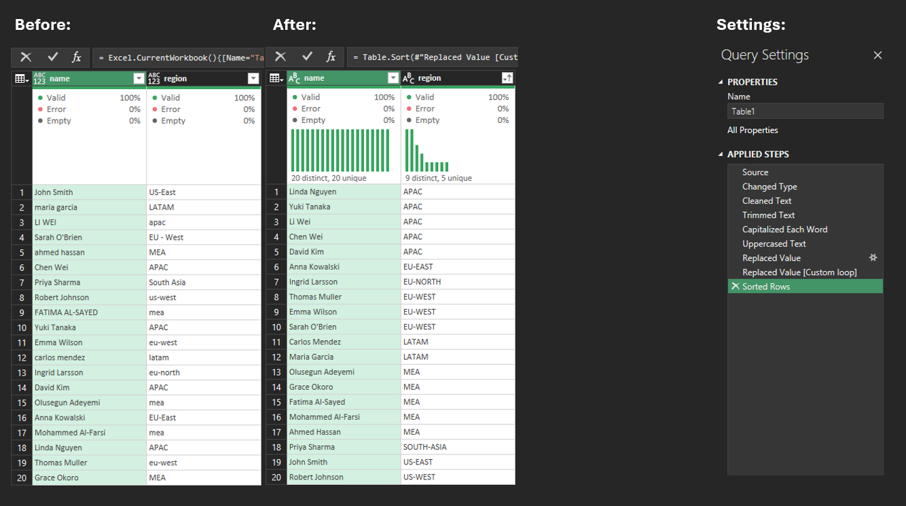
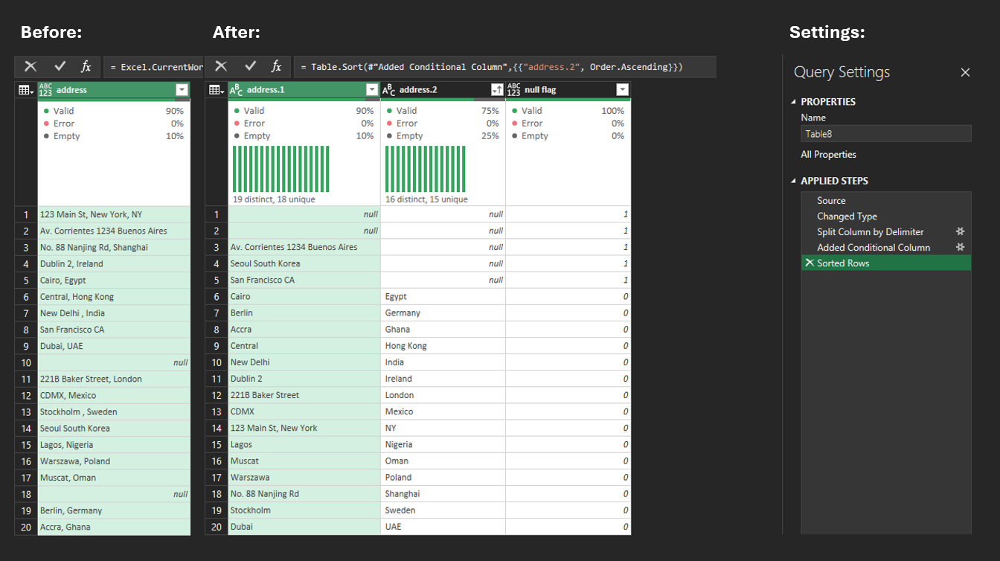
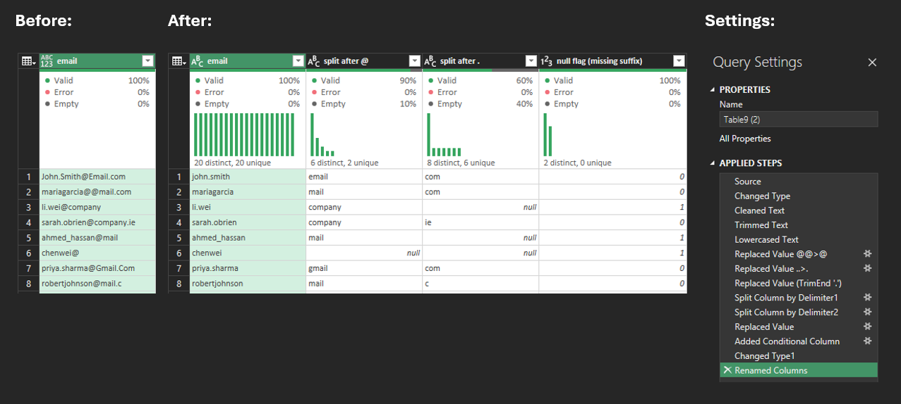
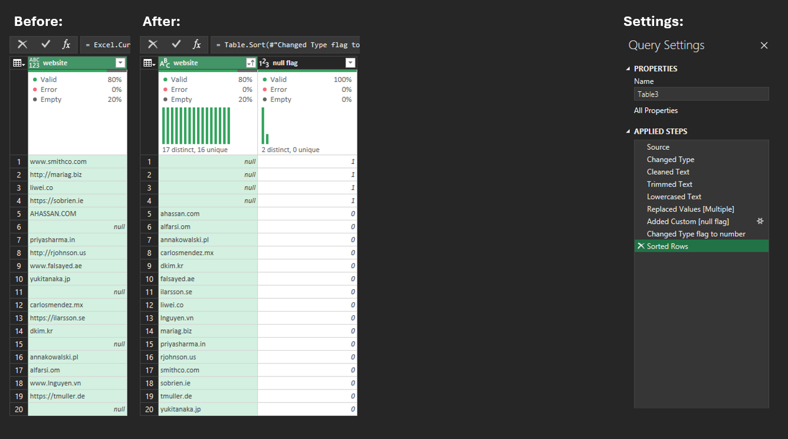
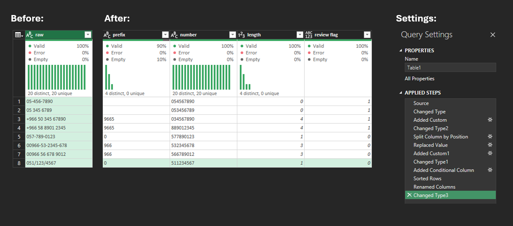
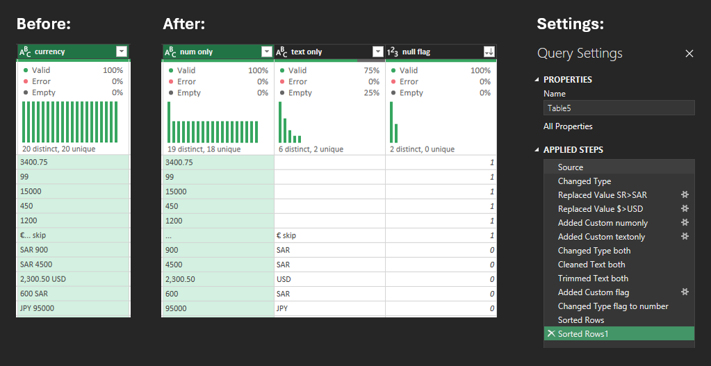
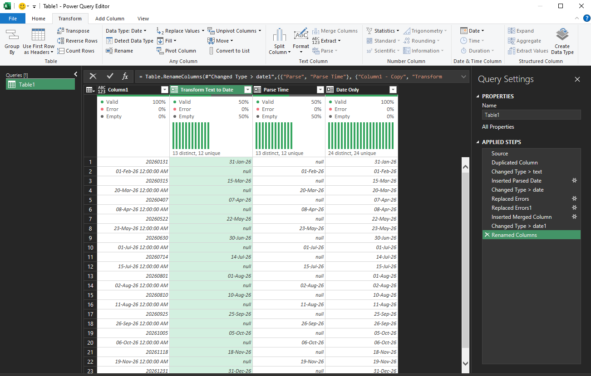

### Extract Text or Numbers Only
Use when a column contains mixed content like "Order123" and you need just the number or just the text.

**Extract numbers only:**
```m
= Text.Select([column_name], {"0".."9"})

// or anything other than numbers
= Text.Remove([column_name], {"0".."9"})
```
l
**Extract letters only:**
```m
= Text.Select([column_name], {"a".."z", "A".."Z"})

// or anything other than letters
= Text.Remove([column_name], {"a".."z", "A".."Z"})
```

### Extract after a delimiter:
```m
// "ORD-00123" becomes "00123"
= Text.AfterDelimiter([column_name], "-")
```

---

### Name & Region
In this step, i replaced region column  ' ' by '-'
which means 'eu - west' will become 'eu---west'

**To solve this**
- insert step > paste code (to remove all multiple - to one -)
```
= let
    FixDashes = (x as text) as text =>
        if Text.Contains(x, "--") then
            @FixDashes(Text.Replace(x, "--", "-"))
        else
            x
in
    Table.TransformColumns(
        #"Replaced Value",
        {{"region", FixDashes, type text}}
    )
```


---
### Address 


---

### Email
To trim the trailing dot
- insert step > paste code ()
```
= Table.TransformColumns(
    #"Replaced Value2",
    {{"email", each Text.TrimEnd(_, "."), type text}}
)
```
- split by delimiter @ and .
- make sure blank columns are null
- null flag 


---
### Website
To replace multiple values such as "www." http and https
- insert step > paste code 
```
= Table.TransformColumns(
    #"Lowercased Text",
    {
            "website",
            each Text.TrimEnd(
                List.Accumulate(
                    {"https://", "http://", "www."},
                    _,
                    (state, current) => Text.Replace(state, current, "")
                ),
                "."
            ),
            type text
    }
)
```
- new column > null flag




---
### Phone numbers
When changing a column type causes errors, convert to text first before changing to the selected column type. 

- To extract "text" from 0..9, to get only numbers, Write the following code
```m
=Text.Select([#"Column"],{"0".."9"})
```
- You may split based on your business needs (In most cases do the following)
```
Home > Split Column > By Number of Characters > number of characters 9 > split : Far Right
```
**Miscellaneous Steps :**
- replace 00 by blank (to turn 00966 to 966)
- add a length column  = Text.Length([Column]) > change type to whole number
- make review flag column > add a conditional column  = if length greater than 3 then 1, if equals 0 then 1 else 0.
- rename all columns



---

### Currency
To get numbers only with .,

- new column > paste code (
```
Text.Select([currency], {"0".."9", ".", ","})
```
- new column > paste code (to get other than numbers and ., "text only")
```
Text.Remove([currency], {"0".."9", ".", ","})
```
- change, clean and trim both to text
- new column > paste code (for flag)
```
if Text.Select([currency], {"0".."9"}) = "" then 1 
else if [text only] = "" then 1
else 0
```


---


### Date Error — How to Handle It
Date errors occur when values are in an unexpected format (e.g., `31/01/2024` vs `2024-01-31`) or when the column contains blanks or text mixed in.
For that reason I've discovered a no-code solution using the following steps.

**Steps :**
- duplicate from the raw column
- turn the duplicated from raw to text
- add column tab > parse date only (from duplicated text column)
- turn the duplicated column from text to date (to enable merging)

**Then to merge :**
- replace errors with nulls in both duplicated column and parsed date column
- add column > merge > duplicated column With parsed date column > no delimiter
- change the merged column type to date


