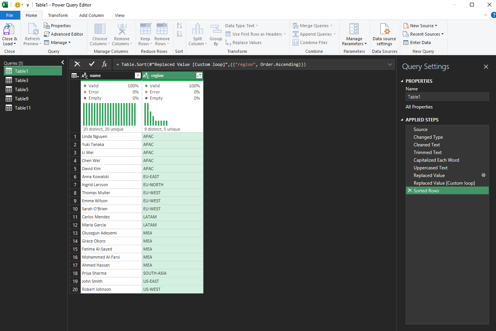
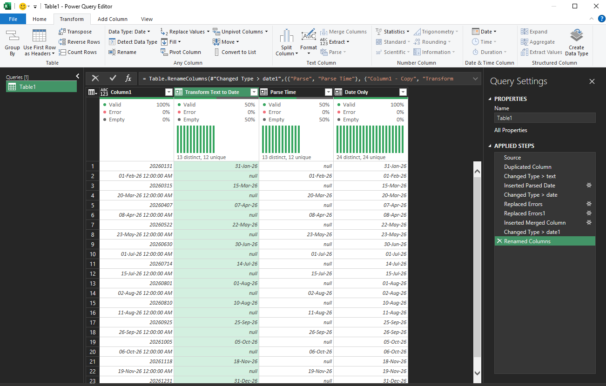

### Extract Text or Numbers Only
Use when a column contains mixed content like "Order123" and you need just the number or just the text.

**Extract numbers only:**
```m
= Text.Select([column_name], {"0".."9"})
```
or anything other than numbers
```m
= Text.Remove([column_name], {"0".."9"})
```

**Extract letters only:**
```m
= Text.Select([column_name], {"a".."z", "A".."Z"})
```
or anything other than letters
```m
= Text.Remove([column_name], {"a".."z", "A".."Z"})
```

### Extract after a delimiter:
```m
= Text.AfterDelimiter([column_name], "-")
// "ORD-00123" becomes "00123"
```
### Name & Region


**Steps :**
- change both type to text
- clean both
- trim both
- name : transform > capitalize each word
- region : transform > uppercase
- region : replace ' ' by '-'
- region : insert step after > paste code (to remove all multiple - to one -)
```
= let
    FixDashes = (x as text) as text =>
        if Text.Contains(x, "--") then
            @FixDashes(Text.Replace(x, "--", "-"))
        else
            x
in
    Table.TransformColumns(
        #"Replaced Value",
        {{"region", FixDashes, type text}}
    )
```



### Phone numbers
When changing a column type causes errors, convert to text first before changing to the target type.

This prevents Power Query from trying to interpret ambiguous values directly.


**Steps :**
- Open powerquery
```
Ctrl+T to the selected table ~> Data tab > From Table/Range
```
- Change column to text
- Write the following code to extract "text" from 0..9, to get only numbers
```m
=Text.Select([#"Column"],{"0".."9"})
```
- You may split based on your business needs (In most cases do the following)
```
Home > Split Column > By Number of Characters > number of characters 9 > split : Far Right
```
**Miscellaneous Steps :**
- replace 00 by blank (to turn 00966 to 966)
- add a length column  = Text.Length([Column]) > change type to whole number
- make review flag column > add a conditional column  = if length greater than 3 then 1, if equals 0 then 1 else 0.
- rename all columns


```
 📸 This is the final result
```
---

### Date Error — How to Handle It
Date errors occur when values are in an unexpected format (e.g., `31/01/2024` vs `2024-01-31`) or when the column contains blanks or text mixed in.
For that reason I've discovered a no-code solution using the following steps.

**Steps :**
- duplicate from the raw column
- turn the duplicated from raw to text
- add column tab > parse date only (from duplicated text column)
- turn the duplicated column from text to date (to enable merging)

**Then to merge :**
- replace errors with nulls in both duplicated column and parsed date column
- add column > merge > duplicated column With parsed date column > no delimiter
- change the merged column type to date


```
 📸 cheers
```
