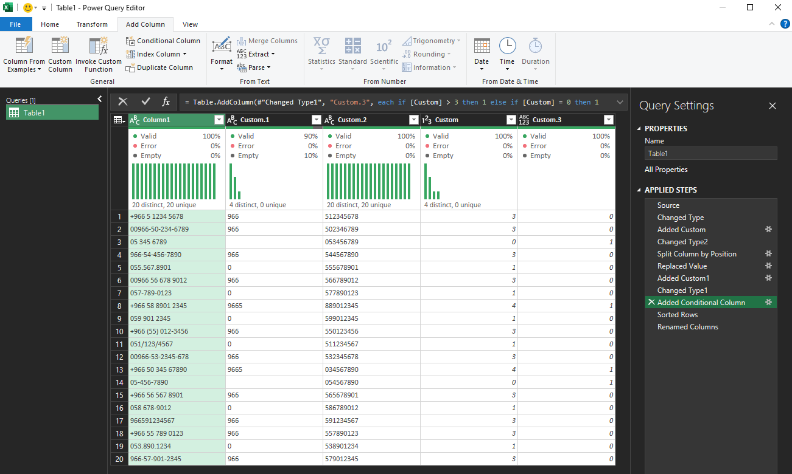

### ToText Method
When changing a column type causes errors, convert to text first before changing to the target type.

This prevents Power Query from trying to interpret ambiguous values directly.

```m
// Ctrl+T to the selected table ~> Data tab > From Table/Range

// Step 1 — Change column to text

// Step 2 — write the following code to extract "text" from 0..9, to get only numbers
=Text.Select([#"Column"],{"0".."9"})

//Step 3 - you can split based on your business needs (In most cases do the following)
- Home > Split Column > By Number of Characters > number of characters 9 > split : Far Right

//misc steps to make flags
- to make 00966 > replace 00 by blank
- add a length column  = Text.Length([Column]) > change type to whole number
- to make review flag column > add a conditional column  = if length greater than 3 then 1, if equals 0 then 1 else 0.
- rename all columns

```

> 📸 This is the final result

---

### Date Error — How to Handle It
Date errors occur when values are in an unexpected format (e.g., `31/01/2024` vs `2024-01-31`) or when the column contains blanks or text mixed in.

**Fix 1 — Force text first then parse:**
```m
= Table.TransformColumns(Source, {{"date_column",
    each try Date.FromText(Text.From(_)) otherwise null,
    type date}})
```

**Fix 2 — Replace errors with null:**
```m
= Table.ReplaceErrorValues(Source, {{"date_column", null}})
```

**Fix 3 — Change regional settings:**
File → Options → Regional Settings → change locale to match your date format (e.g., English (Saudi Arabia) for dd/mm/yyyy)

> 📸 Screenshot: Date error in column → Applied Steps showing the fix → clean result
