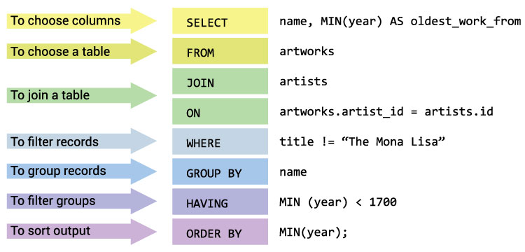
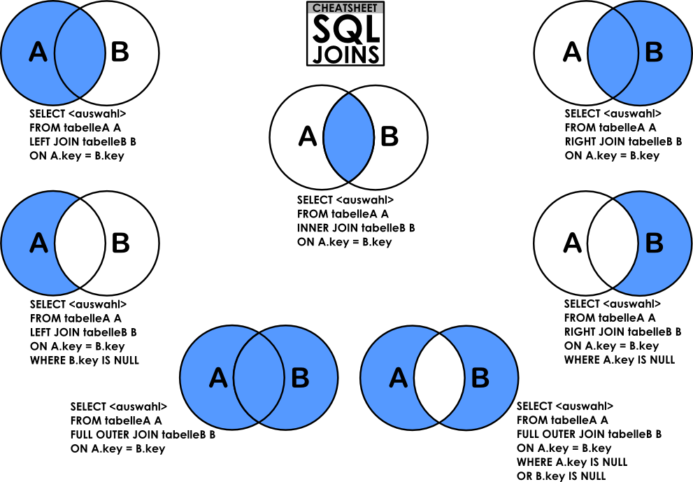
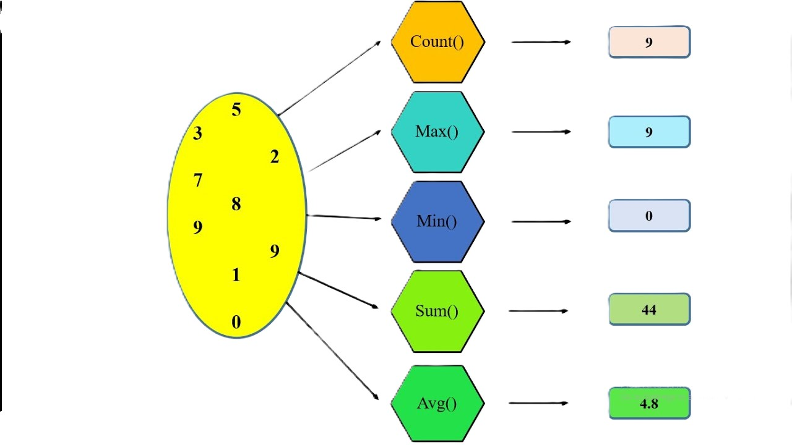

## SQL writing structure



## Full clause explained

- SELECT : choose the columns to return: name, and a calculated oldest_work_from
- FROM : start from the artworks table
- JOIN ... ON — bring in matching rows from artists, linked by artist_id = id
- WHERE : remove any row titled "The Mona Lisa" before grouping happens
- GROUP BY : collapse rows into one per artist name
- HAVING : keep only artists whose earliest work is before the year 1700
- ORDER BY : sort the final result, oldest work first

### Execution order (not the same as the order it's written in):
``` FROM → JOIN → WHERE → GROUP BY → HAVING → SELECT → ORDER BY```
### To Copy :
```
SELECT name, MIN(year) AS oldest_work_from
FROM artworks
JOIN artists
  ON artworks.artist_id = artists.id
WHERE title != 'The Mona Lisa'
GROUP BY name
HAVING MIN(year) < 1700
ORDER BY MIN(year);
```

### join types 


---

## Aggregations

- COUNT()    : counts rows → COUNT(*)
- SUM()    : adds values together → SUM(price)
- AVG()    : calculates the average → AVG(year)
- MIN()    : smallest value → MIN(year)
- MAX()    : largest value → MAX(year)

### SQL example
```
SELECT MIN(year) AS oldest_year,
       MAX(year) AS newest_year,
       COUNT(*)  AS total_artworks
FROM artworks;
```




