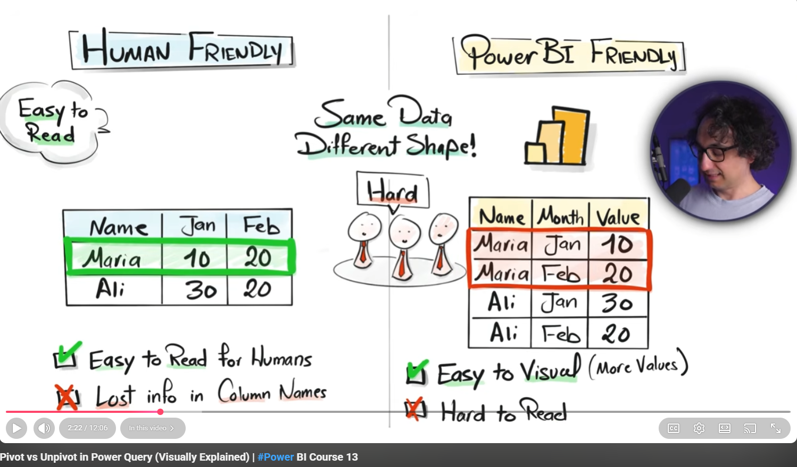
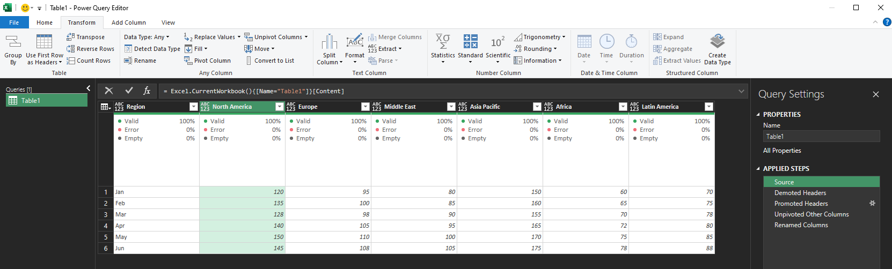
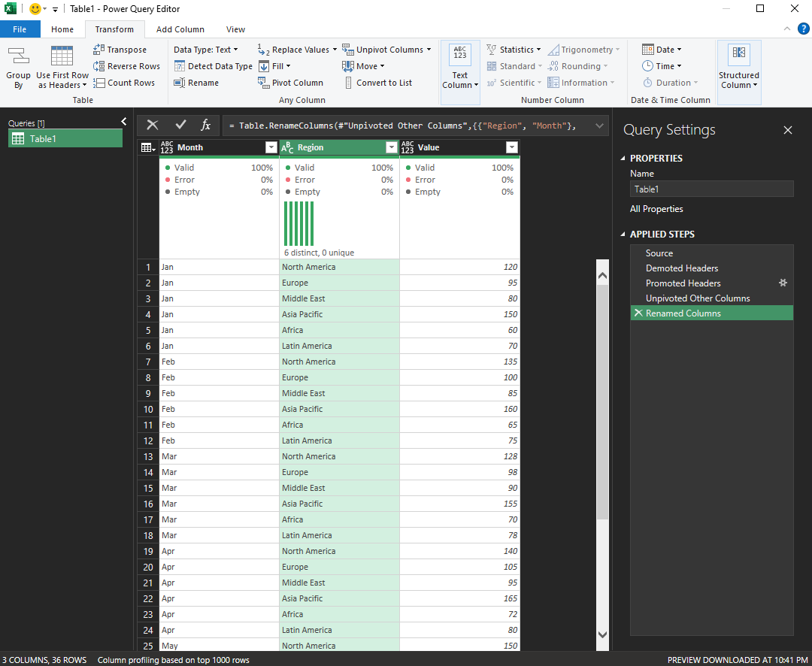
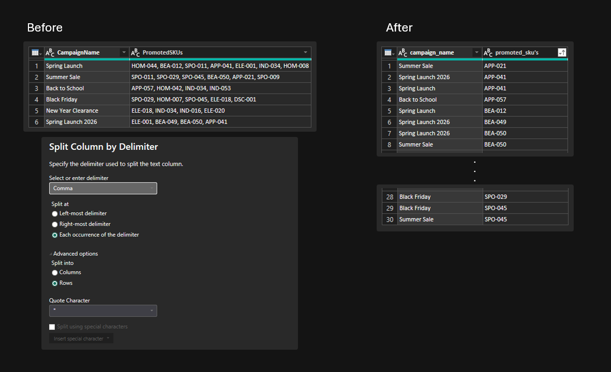

## Unstructured tables

### 1. Use First Row as Headers
When data arrives with no headers or with headers sitting in row 1 as data.

### 2. Transpose
Flips rows and columns. Useful when data arrives with months as rows but you need them as columns, or vice versa.

**Example — before:**

| Product | Jan | Feb | Mar |
|---|---|---|---|
| Widget A | 100 | 120 | 90 |

**After transpose:**

| Product | Widget A |
| --- | --- |
| Jan | 100 |
| Feb | 120 |
| Mar | 90 |

### 3. Unpivot
Converts wide tables (one column per category) into tall tables (one row per value). One of the most important transformations for making real-world data usable in Power BI.

**Example — before:**

~ We select 'Product' then [unpivot other columns]

| Product | Jan | Feb | Mar |
|---|---|---|---|
| Widget A | 100 | 120 | 90 |

**After unpivot:**

| Product | Month | Sales |
|---|---|---|
| Widget A | Jan | 100 |
| Widget A | Feb | 120 |
| Widget A | Mar | 90 |

--- 

## Why we often transpose / unpivot?

Two reasons : 
- To mainly help the Computer (which in our case) Excel, PowerBI, to calculate easily without having to rely on multiple columns for measurements.
- OR we can transpose or unpivot the table based on business needs. (which in most cases to make tables look presentable for stakeholders.)

### Example of Human friendly table : 
*high columns, low rows*

### Example of Computer friendly table : 
*high rows, low columns*

---

## Honorable mention

### 0. Split by rows
Having your table in 'After' format will help ensure that computer can analyze and visualize it, **this method is called split by rows**. 

