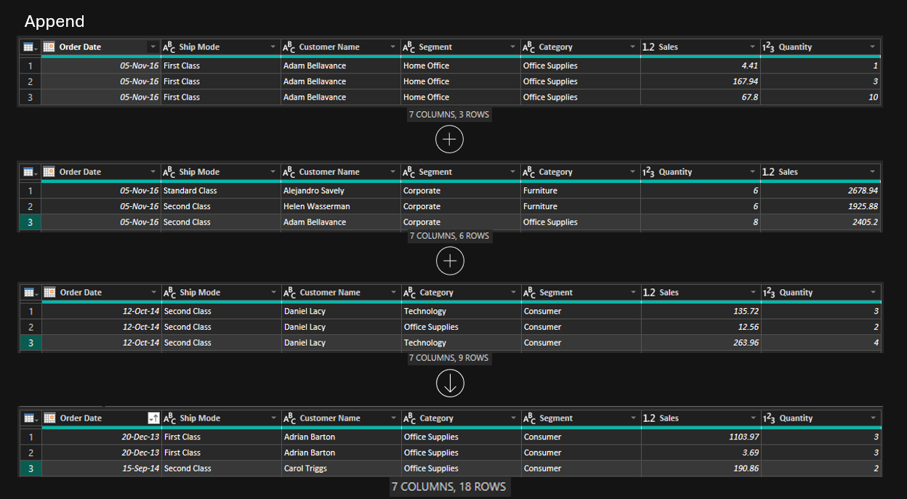
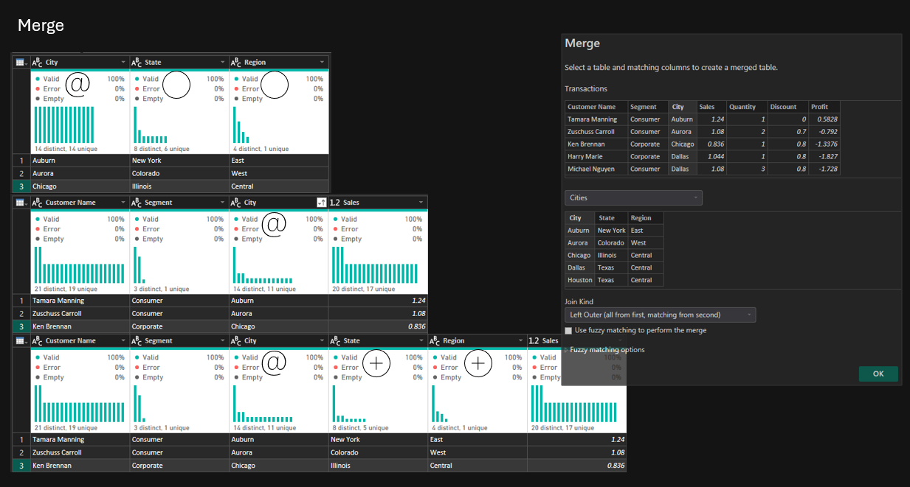
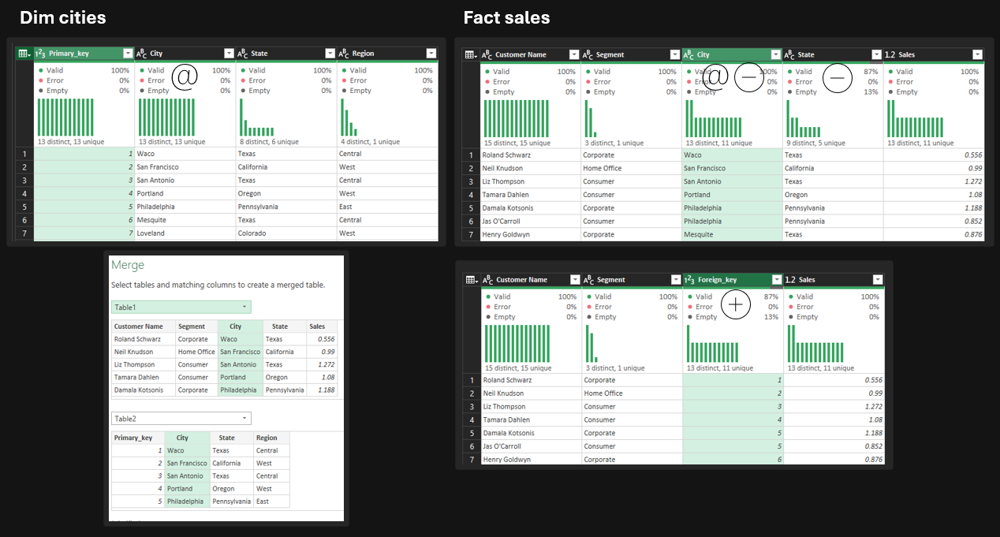
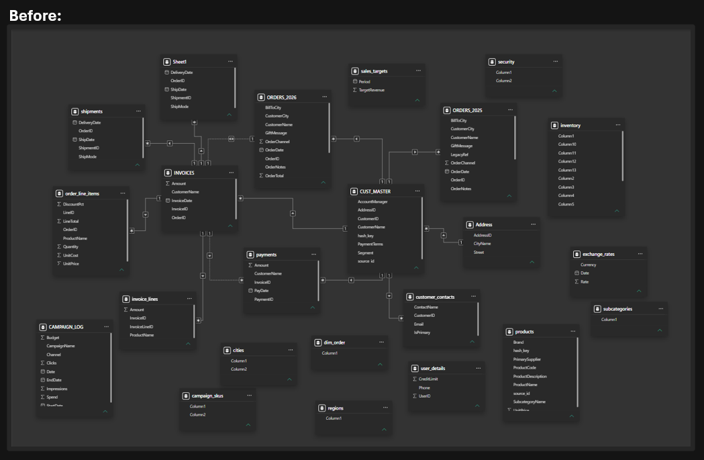
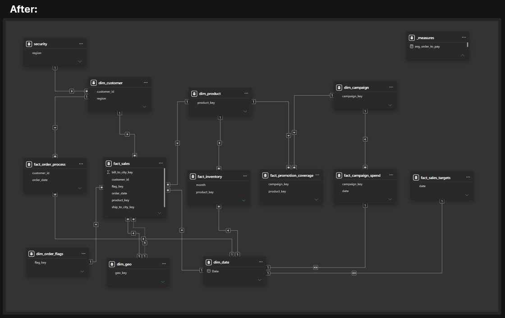

## Append

> Append means stacking rows from different tables with the same column headers into one table  (else the mismatching columons will be added as nulls)

---

## Merge
there are two reasons to use merge, to either enrich the data, or reduce its columns to reduce load and ensure performance.

### Merging to increase columns

### Merging to decrease columns
> And that's often possible by using primary and foreign keys wisely
> 

---

## Index vs Source ID
> It is heavily recommended when joining the tables to use source id than index, 
> Because usually the rows does not get updated in the right order leading to change in the row's pointers, which can create a mismatch, unlike having a single source of truth to rely on, 
> Which in this case a source id.

---

## Summary of technical skills
Following the basics and usage of right tools and methods such as understanding :
- SQL
- joins & filtering
- keys 
- cleaning 
- business domain knowledge
will only get you closer to turn data relationships models from mess to masterpiece.

