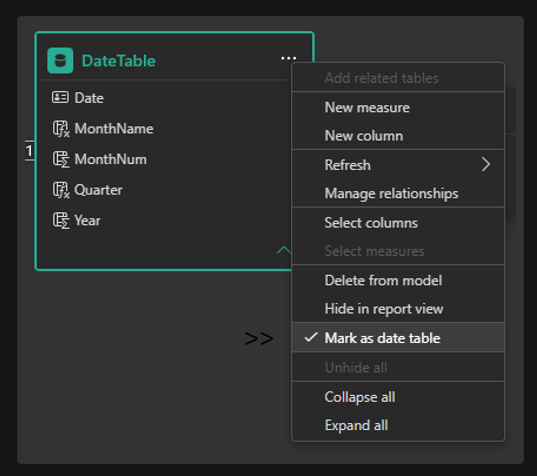
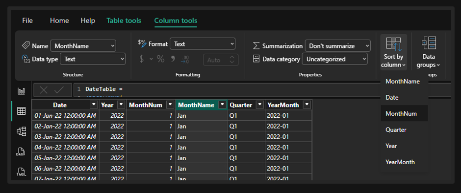
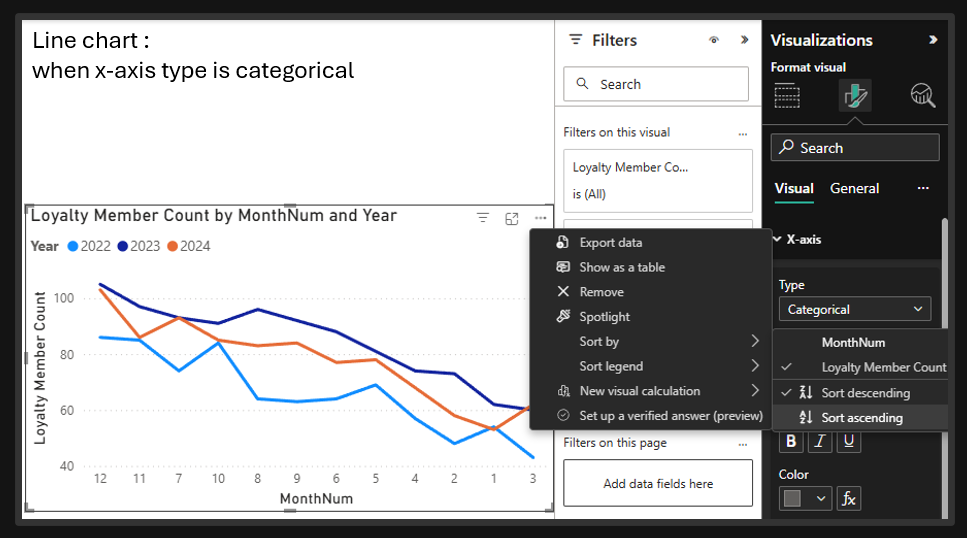
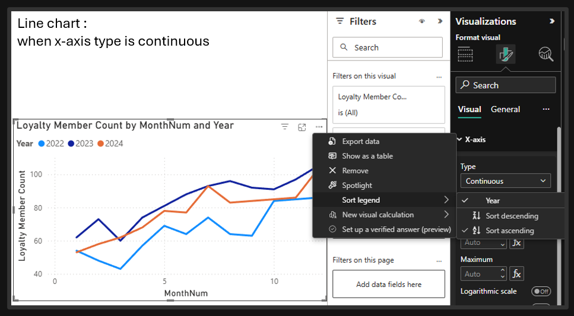

## Date Table
Generating a date table is a repetitive yet necessary task,  <br>
So **instead of writing it every time** we can **copy-paste** the solution right away.


### CALENDAR BASIC
> a simple from-to
```
DateTable = CALENDAR(DATE(2025, 1, 1), DATE(2030, 12, 31))
```

### CALENDAR MANUAL
> can be used and adjusted for every project.

```dax
DateTable =
VAR StartDate = DATE(2025, 1, 1)
VAR EndDate   = DATE(2030, 12, 31)
RETURN
ADDCOLUMNS(
    CALENDAR(StartDate, EndDate),
    "Year", YEAR([Date]),
    "Quarter Number", QUARTER([Date]),
    "Quarter Name", "Q" & QUARTER([Date]),
    "Month Number", MONTH([Date]),
    "Month Name", FORMAT([Date], "MMMM"),
    "Year-Month", FORMAT([Date], "yyyy-MM"),
    "Week Number", WEEKNUM([Date], 1),
    "Day of Week Number", WEEKDAY([Date], 1),
    "Day Number", DAY([Date]),
    "Day Name", FORMAT([Date], "dddd"),
)

```
### CALENDAR AUTO
> It scans your earliest and latest date values across all tables,  <br>
> and builds a continuous range covering complete years.
```
DateTable = CALENDARAUTO()
//DateTable = CALENDARAUTO(1)  -- Fiscal year ends in January
```


### Mark as Date Table
> Mandatory for time intelligence functions to work correctly. <br>
> Otherwise time intelligence DAX functions return blank or incorrect results even if the table looks correct.

Click DateTable in the Fields pane → Table Tools → Mark as Date Table → select the [Date] column <br>
Or simply follow the image below.



### Sort MonthName by MonthNum
> Without this step, months sort alphabetically (Apr, Aug, Dec) instead of chronologically (Jan, Feb, Mar).

Click the MonthName column in DateTable then (Column Tools → Sort by Column → MonthNum) <br>
Or simply follow the image below.



### Discrete vs Continuous Date Axis

| | Discrete (Categorical) | Continuous |
|---|---|---|
| **Appearance** | Even spacing regardless of time gaps | Gaps appear where no data exists |
| **Use when** | Comparing periods as categories | True time series where gaps matter |
| **How to set** | Click axis → type = Categorical | Click axis → type = Continuous |

> Notice categorical can be sorted by values from high to low.
> 



> While continuous can be consistent in timeline
> It can be beneficial in other use cases.


> So whether dealing with categorical or continuous, one must choose based on the business requirements.
>

